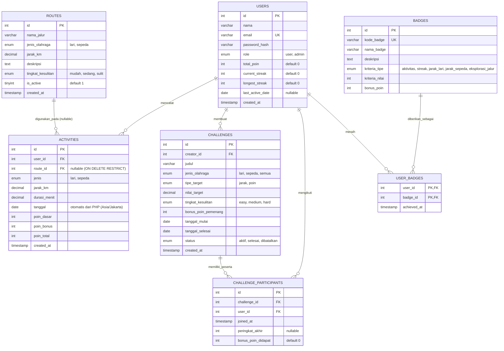

# Product Requirements Document (PRD)
## PaceFire — Platform Web Gamifikasi Olahraga Lari & Bersepeda

**Versi Dokumen:** 1.0  
**Tanggal:** 25 November 2026  
**Jenis Proyek:** Tugas Mata Kuliah Pemrograman Web (Proyek Individu)  
**Tech Stack:** PHP Native, JavaScript (Vanilla), HTML5, CSS3, MySQL/MariaDB (Tanpa Framework & Tanpa Library Eksternal)

---

## 1. Ringkasan Eksekutif & Latar Belakang

### 1.1 Latar Belakang Masalah
Banyak aplikasi pencatatan olahraga bergantung pada perangkat pelacak GPS (*wearable* atau pelacakan *real-time* seluler) untuk memvalidasi aktivitas fisik. Dalam konteks pengembangan web menggunakan *tech stack* murni (*native* tanpa *framework* maupun *library* pihak ketiga), pelacakan GPS secara langsung memiliki keterbatasan teknis dan akurasi. Di sisi lain, sistem pencatatan olahraga sederhana sering kali hanya berupa operasi CRUD biasa yang kurang memotivasi pengguna untuk berolahraga secara konsisten.

### 1.2 Solusi yang Ditawarkan
**PaceFire** adalah aplikasi web gamifikasi olahraga lari dan bersepeda yang mengubah pencatatan aktivitas manual menjadi pengalaman kompetitif dan konsisten. Alih-alih mengandalkan pelacakan perangkat keras, kekuatan utama sistem ini terletak pada **logika aturan main (*game mechanics*) di sisi server**: validasi anti-kecurangan berbasis kalkulasi kecepatan/*pace*, sistem poin dinamis, *daily streak* (api konsistensi), rute/jalur terkurasi ala Strava, lencana pencapaian (*badges*), serta kompetisi komunitas (*challenges*).

### 1.3 Tujuan Proyek
1. Membangun aplikasi web fungsional, aman, dan terstruktur menggunakan PHP Native, HTML5, CSS3, dan Vanilla JS.
2. Menerapkan logika bisnis backend dan relasi database yang kompleks (transaksi database, agregasi *leaderboard*, validasi kalkulatif) melampaui operasi CRUD standar.
3. Menyediakan antarmuka interaktif termasuk visualisasi grafik progres menggunakan elemen `<canvas>` atau `<svg>` bawaan browser.

---

## 2. Target Pengguna & Peran (User Roles)

| Peran | Deskripsi | Hak Akses Utama |
| :--- | :--- | :--- |
| **Pengunjung (Guest)** | Pengguna yang belum memiliki akun atau belum masuk (*login*). | Melihat halaman beranda, cuplikan *leaderboard* global, mendaftar akun baru, dan melakukan *login*. |
| **Pengguna (User)** | Pelari atau pesepeda terdaftar yang menggunakan platform untuk mencatat aktivitas dan berkompetisi. | Mencatat aktivitas olahraga, memilih jalur resmi, melihat riwayat & statistik pribadi, membuat & mengikuti *challenge*, melihat *leaderboard* & koleksi *badge*. |
| **Administrator (Admin)** | Pengelola platform yang menjaga kualitas data dan integritas kompetisi. | Mengelola data master jalur (*routes*), memantau dan memoderasi aktivitas mencurigakan, membatalkan *challenge* bermasalah, dan mengelola master *badge*. |

---

## 3. Ruang Lingkup Produk (Scope)

### 3.1 Fitur Dalam Ruang Lingkup (In-Scope)
* Autentikasi pengguna (Registrasi, Login dengan `password_hash()`, manajemen Session, pemisahan *role* `user` dan `admin`).
* Pencatatan aktivitas olahraga (Lari dan Sepeda) dengan tanggal otomatis hari ini (`Asia/Jakarta`).
* Validasi anti-kecurangan (rentang jarak, *pace*/kecepatan rata-rata, dan batas poin harian).
* Sistem kalkulasi poin otomatis (poin dasar, pengali *streak*, bonus aktivitas harian pertama, dan bonus *milestone*).
* Sistem *Daily Streak* (perhitungan otomatis tanpa *cron job*).
* Manajemen Jalur Olahraga (*Routes*) oleh Admin & opsi pemilihan jalur oleh User (dengan *leaderboard* khusus tiap jalur).
* Sistem *Challenge* (Target Jarak / Target Poin) dengan tingkat kesulitan berjenjang dan *leaderboard* dinamis berbasis waktu bergabung (`joined_at`).
* Sistem *Badge* otomatis & Grafik statistik mingguan berbasis HTML5 `<canvas>` / SVG murni.

### 3.2 Fitur Di Luar Ruang Lingkup / Ditunda (Out-of-Scope / Future Work)
* Pelacakan GPS *real-time* menggunakan Geolocation API browser.
* Fitur aktivitas privat (*Private Activity* / penyembunyian detail aktivitas dari pengguna lain).
* Fitur *Streak Freeze* (perlindungan *streak* saat pengguna absen satu hari).
* Fitur unggah foto bukti aktivitas atau integrasi API pihak ketiga (Strava/Garmin).

---

## 4. Aturan Bisnis & Mekanika Gamifikasi (Business Rules)

### 4.1 Pencatatan & Validasi Aktivitas (Anti-Cheating)
Pengguna hanya mengisi **Jenis Olahraga**, **Jalur (Opsional)**, **Jarak (km)**, dan **Durasi (menit)**. Tanggal aktivitas **tidak diinput oleh pengguna**, melainkan diisi otomatis oleh server PHP menggunakan zona waktu `Asia/Jakarta` (`date('Y-m-d')`) saat formulir dikirimkan.

Setiap aktivitas wajib lolos validasi berikut sebelum disimpan:

| Parameter Validasi | Lari (`running`) | Sepeda (`cycling`) | Keterangan |
| :--- | :--- | :--- | :--- |
| **Jarak Minimum** | $1\text{ km}$ | $3\text{ km}$ | Mencegah *spam* input jarak pendek untuk menjaga *streak*. |
| **Jarak Maksimum / Sesi** | $42\text{ km}$ | $150\text{ km}$ | Batas wajar per satu kali pencatatan aktivitas. |
| **Metrik Kecepatan** | *Pace*: `3:00` – `15:00` /km | Kecepatan: $8$ – $45\text{ km/jam}$ | $\text{Pace} = \frac{\text{Durasi (menit)}}{\text{Jarak (km)}}$; $\text{Kecepatan} = \frac{\text{Jarak (km)}}{\text{Durasi (jam)}}$. |
| **Batas Poin Harian** | Maksimal **$500\text{ poin}$ / hari** | Maksimal **$500\text{ poin}$ / hari** | Gabungan seluruh aktivitas valid pada tanggal yang sama. |

* **Aturan Modifikasi:** Pengguna **tidak dapat mengedit atau menghapus** aktivitas yang sudah tersimpan. Hanya Admin yang dapat menghapus aktivitas terindikasi curang; penghapusan oleh Admin memicu kalkulasi ulang `total_poin` dan status *streak* pengguna terkait.

### 4.2 Formula Perhitungan Poin
Poin berlaku secara **global** untuk semua aktivitas valid. Nilai poin disimpan sebagai *snapshot* pada tabel `activities` (`poin_dasar`, `poin_bonus`, `poin_total`).

$$\text{Poin Dasar} = \lfloor \text{Jarak (km)} \times \text{Tarif per km} \rfloor$$

* **Tarif Lari:** $10\text{ poin/km}$
* **Tarif Sepeda:** $3\text{ poin/km}$

$$\text{Poin Bonus} = \text{Bonus Pengali Streak} + \text{Bonus Aktivitas Pertama Harian}$$

1. **Bonus Pengali Streak:**
   * Streak $1 - 2\text{ hari}$: $\times 1.0$ (Bonus $+0\%$)
   * Streak $3 - 6\text{ hari}$: $\times 1.1$ (Bonus $\lfloor \text{Poin Dasar} \times 0.10 \rfloor$)
   * Streak $7 - 13\text{ hari}$: $\times 1.25$ (Bonus $\lfloor \text{Poin Dasar} \times 0.25 \rfloor$)
   * Streak $\ge 14\text{ hari}$: $\times 1.5$ (Bonus $\lfloor \text{Poin Dasar} \times 0.50 \rfloor$)
2. **Bonus Aktivitas Pertama Harian:** $+5\text{ poin}$ diberikan hanya pada aktivitas valid pertama di tanggal tersebut.

$$\text{Poin Total} = \text{Poin Dasar} + \text{Poin Bonus}$$

*(Catatan: Jika `Poin Total` menyebabkan akumulasi poin pengguna hari itu melebihi $500\text{ poin}$, sistem akan menolak atau membatasi perolehan poin pada sisa kuota harian).*

### 4.3 Mekanika Daily Streak
* **Definisi Hari Aktif:** Memiliki minimal 1 aktivitas valid pada tanggal tersebut (`Y-m-d`).
* **Pembaruan Saat Aktivitas Disimpan:**
  * Jika `last_active_date == hari_ini`: `current_streak` tidak berubah.
  * Jika `last_active_date == kemarin`: `current_streak = current_streak + 1`.
  * Selain kondisi di atas (atau `NULL`): `current_streak = 1`.
  * Perbarui `longest_streak = max(longest_streak, current_streak)` dan `last_active_date = hari_ini`.
* **Evaluasi Tampilan (Tanpa Cron Job):** Saat pengguna membuka Dashboard atau Profil, jika `last_active_date < kemarin`, sistem menampilkan `current_streak` sebagai `0` (api padam).

### 4.4 Sistem Jalur (Routes)
* Jalur dibuat dan dikelola secara eksklusif oleh **Admin**.
* Jika pengguna memilih jalur saat mencatat aktivitas, kolom **Jarak** otomatis terisi sesuai `jarak_resmi` jalur tersebut dan dikunci (`readonly`). Pengguna cukup memasukkan durasi.
* Setiap jalur memiliki **Leaderboard Jalur** (diurutkan berdasarkan waktu/durasi tercepat) serta catatan **Personal Best (PB)** untuk masing-masing pengguna.
* **Penghapusan Jalur:** Admin menggunakan mekanisme *soft-delete* (`is_active = 0`) agar riwayat aktivitas lama pengguna yang pernah melewati jalur tersebut tidak rusak.

### 4.5 Sistem Challenge & Tingkat Kesulitan
Pengguna dapat membuat *challenge* baru dan otomatis terdaftar sebagai peserta pertama. Peserta lain dapat bergabung selama status *challenge* masih `aktif`.

* **Perhitungan Progres:** Hanya menghitung aktivitas yang sesuai dengan `jenis_olahraga` *challenge* dan tercatat pada rentang:
  $$\text{tanggal\_aktivitas} \ge \max(\text{tanggal\_mulai}, \text{DATE}(\text{joined\_at})) \quad \text{dan} \quad \text{tanggal\_aktivitas} \le \text{tanggal\_selesai}$$
* **Mekanisme Penyelesaian Challenge:**
  1. **Tipe Target Jarak (`jarak`):** Berlomba mencapai target jarak tertentu (misal: $50\text{ km}$). **Segera setelah ada 1 peserta yang mencapai/melampaui nilai target**, *challenge* langsung ditutup secara otomatis (status berubah menjadi `selesai`), peserta tersebut ditetapkan sebagai Peringkat 1 (Pemenang), dan peringkat peserta lain diurutkan berdasarkan akumulasi jarak saat itu. Jika hingga `tanggal_selesai` belum ada yang mencapai target, pemenang ditentukan berdasarkan jarak terjauh.
  2. **Tipe Target Poin (`poin`):** Mengumpulkan poin sebanyak-banyaknya hingga `tanggal_selesai` berakhir. Pemenang adalah peserta dengan akumulasi poin tertinggi saat periode berakhir.
* **Kategori Tingkat Kesulitan & Bonus Poin Pemenang (Juara 1):**
  Saat membuat *challenge*, pembuat memilih kategori tingkat kesulitan yang menentukan besaran `bonus_poin` untuk Peringkat 1:

| Tingkat Kesulitan | Deskripsi / Kriteria Umum | Bonus Poin Pemenang (Juara 1) |
| :--- | :--- | :--- |
| **Mudah (`easy`)** | Target ringan atau durasi singkat (misal: $10 - 20\text{ km}$ atau $3 - 5\text{ hari}$). | **$+50\text{ poin}$** |
| **Menengah (`medium`)** | Target moderat (misal: $21 - 50\text{ km}$ atau $1 - 2\text{ minggu}$). | **$+100\text{ poin}$** |
| **Sulit (`hard`)** | Target intensif / ketahanan tinggi (misal: $> 50\text{ km}$ atau $\ge 3\text{ minggu}$). | **$+200\text{ poin}$** |

### 4.6 Daftar Master Badge (Lencana Pencapaian)
Badge dicek secara otomatis di dalam transaksi database setiap kali aktivitas valid disimpan. Setiap badge hanya dapat diraih **satu kali seumur hidup** per pengguna dan memberikan tambahan `bonus_poin` ke `users.total_poin`.

| Kode / Nama Badge | Kategori | Syarat Pencapaian | Bonus Poin |
| :--- | :--- | :--- | :--- |
| **Langkah Pertama** | Aktivitas | Menyelesaikan $1$ aktivitas valid pertama (lari atau sepeda). | $+10\text{ poin}$ |
| **Api Menyala (7 Hari)** | Streak | Mencapai `current_streak` sebesar $7\text{ hari}$ berturut-turut. | $+50\text{ poin}$ |
| **Tak Terhentikan (30 Hari)** | Streak | Mencapai `current_streak` sebesar $30\text{ hari}$ berturut-turut. | $+200\text{ poin}$ |
| **Pelari Setengah Maraton** | Jarak Lari | Mengumpulkan total akumulasi jarak lari $\ge 21\text{ km}$. | $+50\text{ poin}$ |
| **Penakluk Maraton** | Jarak Lari | Mengumpulkan total akumulasi jarak lari $\ge 42\text{ km}$. | $+100\text{ poin}$ |
| **Gowes Century** | Jarak Sepeda | Mengumpulkan total akumulasi jarak bersepeda $\ge 100\text{ km}$. | $+75\text{ poin}$ |
| **Penjelajah Jalur** | Eksplorasi | Menyelesaikan minimal $3$ jalur resmi (`route_id`) yang berbeda. | $+40\text{ poin}$ |

---

## 5. Spesifikasi Fungsional Halaman & Alur Pengguna

### 5.1 Daftar Halaman
1. **Zona Publik:**
   * `index.php` (Beranda): Informasi aplikasi, ringkasan fitur, dan Top 5 *Leaderboard* Global.
   * `register.php` & `login.php`: Formulir pendaftaran dan masuk sistem.
2. **Zona User (Membutuhkan Session `role = 'user'`):**
   * `dashboard.php`: Ringkasan total poin, status *streak* (ikon api aktif/padam), grafik batang/garis aktivitas 7 hari terakhir (HTML5 `<canvas>`), daftar *challenge* yang sedang diikuti, dan badge terbaru.
   * `activity_create.php`: Formulir catat aktivitas (pilihan jenis olahraga memfilter *dropdown* jalur secara dinamis via JS; memilih jalur mengunci input jarak).
   * `activity_history.php`: Tabel riwayat aktivitas pribadi dengan filter jenis olahraga dan rentang tanggal, menampilkan kalkulasi *pace* (`mm:ss /km`) untuk lari dan `km/jam` untuk sepeda.
   * `routes.php` & `route_detail.php`: Daftar jalur aktif beserta tingkat kesulitannya, detail rute, *Personal Best* pengguna, *Leaderboard* tercepat jalur, dan tombol pintasan *"Catat Aktivitas di Jalur Ini"*.
   * `challenges.php`, `challenge_create.php`, & `challenge_detail.php`: Daftar *challenge* (Tab: Tersedia, Diikuti, Selesai), formulir pembuatan *challenge*, serta halaman detail berisi progres peserta dan *leaderboard* *challenge*.
   * `leaderboard.php`: Peringkat global seluruh pengguna berdasarkan `total_poin`.
   * `profile.php`: Statistik keseluruhan, rekor `longest_streak`, etalase koleksi *badge* (terkunci vs terbuka), dan fitur ubah kata sandi.
3. **Zona Admin (Membutuhkan Session `role = 'admin'`):**
   * `admin/index.php`: Statistik ringkas sistem (total pengguna, total aktivitas hari ini, jumlah *challenge* aktif).
   * `admin/routes.php`: CRUD Jalur Olahraga (Tambah, Edit, Aktifkan/Nonaktifkan via `is_active`).
   * `admin/activities.php`: Daftar seluruh aktivitas pengguna dengan indikator aktivitas ekstrem dan tombol hapus (disertai konfirmasi dan proses hitung ulang poin/streak user).
   * `admin/challenges.php`: Pemantauan seluruh *challenge* dan opsi pembatalan jika ditemukan pelanggaran.

### 5.2 Alur Transaksi Pencatatan Aktivitas (Core Flow)
1. User mengirimkan formulir dari `activity_create.php`.
2. Backend melakukan sanitasi input dan menjalankan validasi aturan bisnis (jarak min/maks, *pace*/kecepatan, dan batas $500\text{ poin}$/hari). Jika gagal, kembalikan ke formulir dengan pesan galat spesifik dan pertahankan nilai input sebelumnya.
3. Jika validasi lolos, backend memulai **Database Transaction (`PDO::beginTransaction()`)**:
   * Hitung `poin_dasar`, `poin_bonus`, dan `poin_total`.
   * `INSERT` data ke tabel `activities`.
   * Hitung pembaruan `current_streak` dan `longest_streak`.
   * Cek apakah pengguna memenuhi syarat *badge* baru yang belum dimiliki; jika ya, `INSERT` ke `user_badges` dan tambahkan `bonus_poin` badge.
   * `UPDATE` cache `total_poin`, `current_streak`, `longest_streak`, dan `last_active_date` pada tabel `users`.
   * Cek apakah aktivitas ini membuat pengguna mencapai target pada salah satu *challenge* bertipe `jarak` yang sedang diikuti; jika ya, jalankan prosedur penutupan *challenge* dan pemberian bonus juara.
4. `PDO::commit()` dan arahkan pengguna ke `dashboard.php` dengan *flash message* ringkasan perolehan poin, status *streak*, dan notifikasi jika meraih *badge* baru atau memenangkan *challenge*.

---

## 6. Desain Basis Data (ERD)

Berikut adalah diagram Entity-Relationship (ERD) yang merepresentasikan skema tabel MySQL/MariaDB pada sistem **PaceFire**:



---

## 7. Struktur Folder Proyek (PHP Native)

Struktur direktori dirancang modular untuk memisahkan konfigurasi, logika bisnis (*helpers/services*), komponen tampilan (*includes*), aset statis, dan halaman antarmuka pengguna maupun admin:

```text
pacefire/
├── config/
│   ├── database.php          # Koneksi PDO MySQL & pengaturan timezone Asia/Jakarta
│   └── constants.php         # Konstanta aturan main (tarif poin, batas validasi, tier challenge)
├── includes/
│   ├── auth_check.php        # Middleware pengecekan session login & validasi role (user/admin)
│   ├── functions.php         # Helper umum (format pace mm:ss, sanitasi XSS, flash messages)
│   ├── gamification.php      # Logika inti: hitung poin, update streak, cek badge, evaluasi challenge
│   ├── header.php            # Template HTML <head> & navigasi utama dinamis sesuai role
│   └── footer.php            # Template footer & pemanggilan script JS global
├── assets/
│   ├── css/
│   │   ├── style.css         # Desain tata letak utama, variabel warna, kartu statistik, tabel
│   │   └── auth.css          # Styling khusus halaman login & registrasi
│   └── js/
│       ├── main.js           # Interaktivitas UI umum, alert auto-dismiss, konfirmasi aksi
│       ├── activity_form.js  # Logika filter jalur berdasarkan olahraga & penguncian input jarak
│       └── dashboard_chart.js# Script HTML5 <canvas> murni untuk menggambar grafik aktivitas mingguan
├── admin/
│   ├── index.php             # Dashboard ringkasan administrator
│   ├── routes.php            # Manajemen CRUD & toggle status aktif jalur
│   ├── activities.php        # Moderasi & penghapusan aktivitas + rekalkulasi user
│   └── challenges.php        # Pemantauan & pembatalan challenge
├── database/
│   └── schema.sql            # Skema DDL tabel lengkap & data seeder awal (badges & contoh routes)
├── index.php                 # Halaman beranda publik
├── register.php              # Halaman pendaftaran akun baru
├── login.php                 # Halaman masuk pengguna & admin
├── logout.php                # Penghancuran session & redirect
├── dashboard.php             # Halaman utama pengguna setelah login
├── activity_create.php       # Halaman form pencatatan aktivitas
├── activity_history.php      # Halaman riwayat aktivitas pengguna
├── routes.php                # Halaman katalog jalur olahraga
├── route_detail.php          # Halaman detail jalur & leaderboard tercepat jalur
├── challenges.php            # Halaman daftar challenge (Tersedia, Diikuti, Selesai)
├── challenge_create.php      # Halaman form pembuatan challenge baru
├── challenge_detail.php      # Halaman detail challenge, progres, & leaderboard
├── leaderboard.php           # Halaman peringkat global pengguna
└── profile.php               # Halaman profil, statistik rekor, & etalase badge
```

---

## 8. Kebutuhan Non-Fungsional & Keamanan

1. **Keamanan Basis Data:** Seluruh kueri SQL wajib menggunakan *Prepared Statements* (`PDO::prepare` dan `execute`) untuk mencegah serangan *SQL Injection*.
2. **Keamanan Autentikasi & Sesi:** Kata sandi disimpan menggunakan `password_hash($password, PASSWORD_DEFAULT)` dan diverifikasi dengan `password_verify()`. Session ID diregenerasi (`session_regenerate_id(true)`) setelah pengguna berhasil *login* untuk mencegah *Session Fixation*.
3. **Pencegahan XSS & CSRF:** Seluruh output teks yang berasal dari input pengguna wajib dibersihkan dengan `htmlspecialchars($str, ENT_QUOTES, 'UTF-8')`. Setiap formulir `POST` dilengkapi token CSRF sederhana yang disimpan di `$_SESSION`.
4. **Konsistensi Data (ACID):** Proses penyimpanan aktivitas yang melibatkan pembaruan lintas tabel (`activities`, `users`, `user_badges`, `challenges`) wajib dibungkus dalam transaksi database (`beginTransaction`, `commit`, `rollBack`).
5. **Kepatuhan Aturan Akademik:** Tidak menggunakan *framework* CSS/JS (seperti Bootstrap, Tailwind, jQuery, Chart.js) maupun *framework* PHP (seperti Laravel, CodeIgniter). Seluruh komponen antarmuka, validasi klien, dan grafik dibangun dari kode murni.